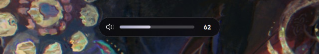
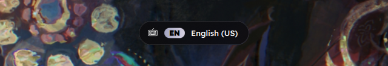

# plasma-glass-osd

A glass capsule on-screen display for KDE Plasma 6. It replaces the popup you see when you change the volume, the keyboard layout, screen brightness and so on, and puts it at the top of the screen.

I got tired of the stock OSD sitting in the middle of the screen, so this started as "move it up" and grew from there.





## What it does

- Shows a translucent capsule at the top of the active screen. KWin blurs exactly the capsule shape behind it, rounded corners included. The background stays dark enough to read over white windows.
- Colors the volume bar and the layout chip with your accent color.
- Grows the capsule out of a small pill on show and collapses it to nothing on hide, so no blur is left behind.
- Animates the capsule width when the content changes, and the content moves with the edges.
- Morphs text one character at a time. Volume digits roll up or down depending on the direction of the change, and only the digits that changed move.
- Flows between kinds of OSD. Going from volume to keyboard layout, the bar fill shrinks into the layout chip, the icon blurs into the new one and the number fades out while the layout name fades in.
- Stretches like a rubber band when you press a volume key at 0% or at the maximum, the way an iOS slider does when pulled past its end. It uses the UIScrollView rubber band curve `(1 - 1 / (x * 0.55 / d + 1)) * d` and a critically damped spring, so it never overshoots.
- Shows a short code chip for keyboard layouts (EN, RU, UA and so on).
- Turns the number amber above 100% and red above 125%.
- Moves by fractions of a pixel while animating and sits on whole pixels at rest, so icons stay crisp.

It covers every OSD Plasma sends: speaker and microphone volume, per-player volume, screen and keyboard brightness, keyboard layout, power profile, Wi-Fi, Bluetooth, touchpad and the rest. I have only checked volume and keyboard layout on a real desktop so far.

## Requirements

- Plasma 6 on Wayland, with plasmashell started as the `plasma-plasmashell` systemd user service (the default). Tested on Plasma 6.8.1, Qt 6.12, KDE Frameworks 6.31.
- KWin's blur effect, or a replacement such as Better Blur DX. Without one you get a plain dark capsule.
- cmake, a C++ compiler, Qt 6 (base and declarative) and KWindowSystem development files. On Arch:

  ```
  sudo pacman -S --needed base-devel cmake qt6-base qt6-declarative kwindowsystem
  ```

- The capsule uses the [Readex Pro](https://fonts.google.com/specimen/Readex+Pro) font if you have it installed and falls back to the default font otherwise.

## Install

```
git clone https://github.com/zxsleebu/plasma-glass-osd
cd plasma-glass-osd
./install.sh
```

The script builds a small blur helper, assembles the OSD module in `~/.local/share/plasma-glass-osd` and restarts plasmashell. Nothing goes outside your home directory and it never asks for root.

Run `./install.sh` again after a Plasma update. It rebuilds the module against the new system files.

## Uninstall

```
./uninstall.sh
```

This removes the files and the systemd drop-in and restarts plasmashell with the stock OSD.

## How it works

Plasma draws the OSD with the QML module `org.kde.plasma.workspace.osd`. The install script copies the module's `qmldir` into your home directory, drops the line that makes Qt prefer the copy compiled into plasmashell, links the original C++ plugin and adds the QML files from this repo. A systemd drop-in then sets `QML_IMPORT_PATH` for plasmashell, so it loads this version of the module first.

The window is a layer-shell surface instead of a Plasma dialog, because the dialog keeps resetting the blur region. The blur helper (`blur/`) is a tiny QML plugin that asks KWin to blur a rounded rectangle through KWindowEffects. The QML updates that rectangle every frame to follow the capsule.

## Tweaking

Edit the files in `qml/` and run `./install.sh` again. Some values worth knowing:

| File | Property | What it changes |
| --- | --- | --- |
| `Osd.qml` | `topMargin` | distance from the top of the screen |
| `Osd.qml` | `maxCapsuleWidth` | longest the capsule gets before text is cut |
| `Osd.qml` | `color` of `capsule` | glass tint, alpha 0.72 by default |
| `Osd.qml` | `stretchLimit`, `pullPerPress`, `releaseResponse` | the rubber band at the volume limits |
| `OsdItem.qml` | `fontFamily`, `fontWeight` | font |
| `OsdItem.qml` | `moveDuration` | speed of transitions between kinds of OSD |
| `MorphText.qml` | `duration`, `stagger` | speed of the character morph |

## Known issues

- The override depends on how plasmashell builds its OSD. A future Plasma release can change that. If the OSD disappears after an update, run `./install.sh` again, and if that does not help, `./uninstall.sh` brings back the stock one.
- The drop-in sets `QML_IMPORT_PATH` for plasmashell. If you already set that variable for plasmashell somewhere else, one of the two will win.
- Wayland only. I have not tried X11.

## Credits

The rubber band constants and the spring come from [fluid-scroll](https://github.com/ktiays/fluid-scroll) by ktiays (Apache-2.0), a Rust port of iOS scrolling physics.

## License

GPL-2.0-or-later, same as Plasma itself.
